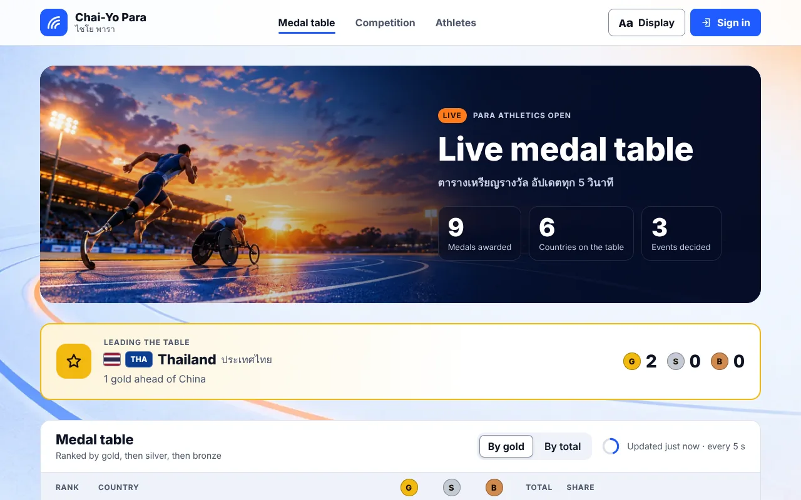
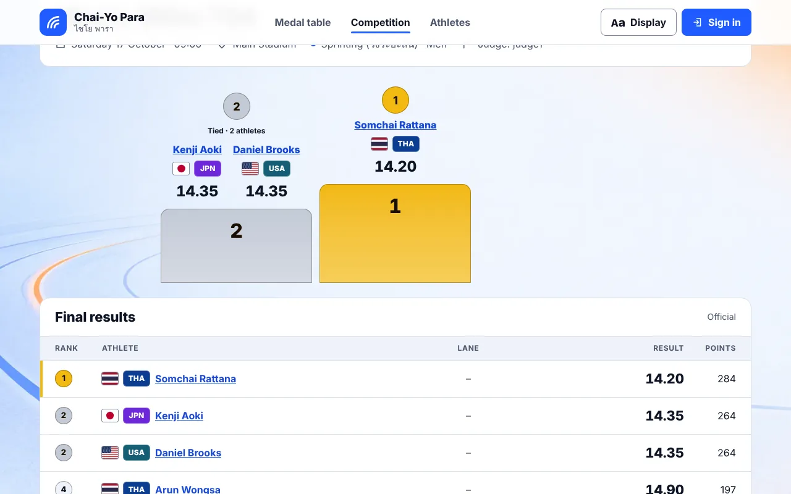
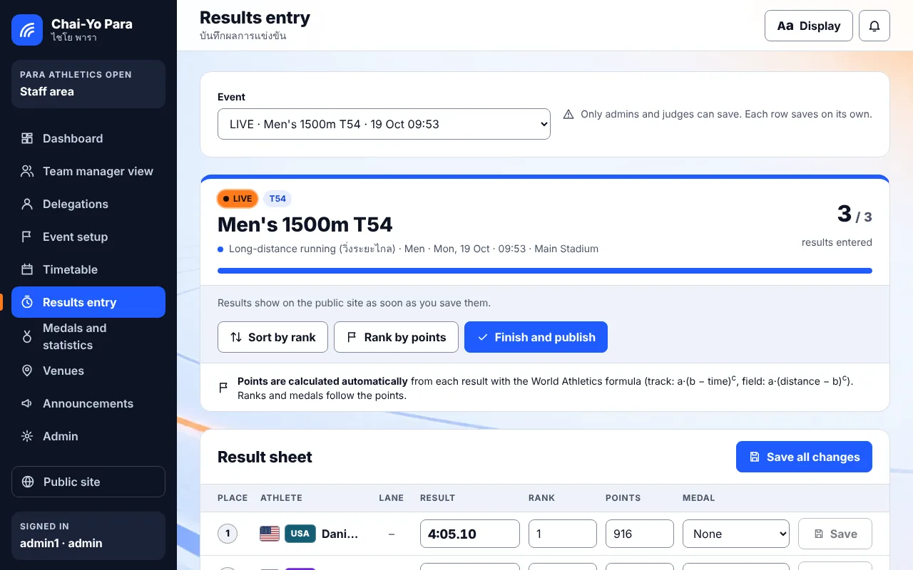
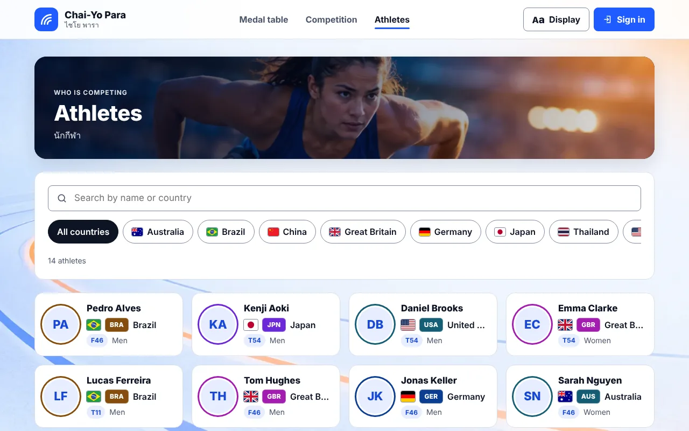
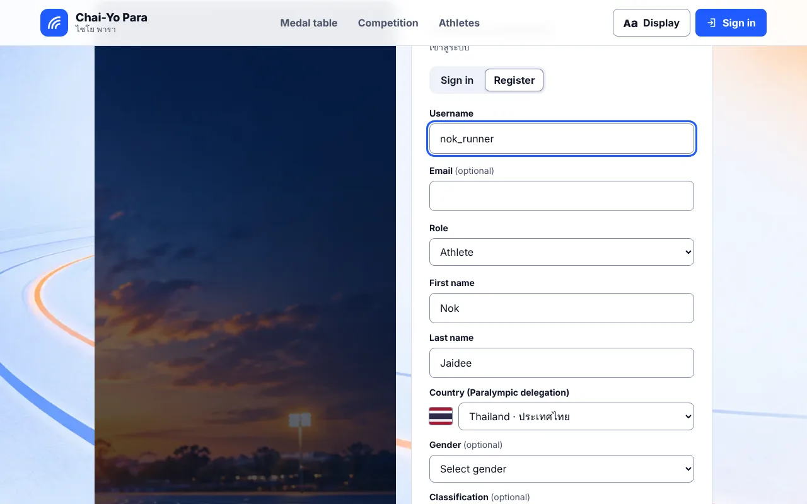
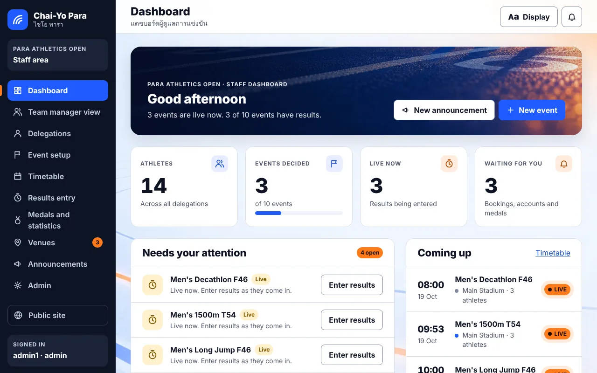
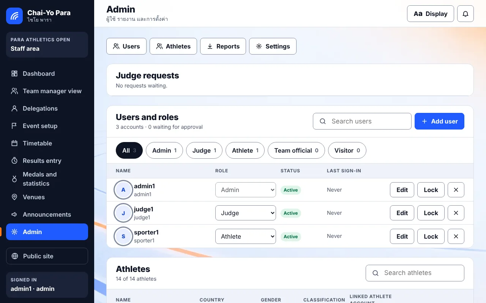

# Chai-Yo Para · ไชโย พารา

**A competition management system for Paralympic track and field**: live medal table, schedules and results for the public, and a staff area where admins run events and judges enter results.

Built as a 4-person university project (Digital Media Engineering, Khon Kaen University) with **Django REST Framework + PostgreSQL** and a **plain HTML, CSS and JavaScript** frontend (no framework, as the brief required).

**▶ Live demo:** *add your Vercel link here*. The demo runs on built-in sample data, so you can sign in as `admin1` or `judge1` (password `test1234`).



## Highlights

- **Live medal table** that updates every 5 seconds, with flags for all 170 delegations of the Paris 2024 Paralympic Games.
- **Automatic points.** Every result is turned into points with the World Athletics formula (`a·(b − T)^c` for track, `a·(D − b)^c` for field). Events are ranked by points, so athletes from different classes can be compared fairly. Admins can edit the coefficients.
- **Real tie handling.** Equal results share a rank (1, 1, 3), and tied athletes share the podium step.
- **Five roles:** admin, judge, athlete, team official and visitor, each with its own permissions.
  - **Judges** request an account and an admin approves it. A judge can only enter results for their own event while it is live.
  - **Athletes** register with their country, chosen from the official list of delegations, and get a competition profile.
- **Event flow:** start list → live → result. Events follow the real clock automatically, or an admin can take control by hand.
- **Accessibility:** a Display menu with larger text, high contrast, dark mode and reduced motion, a skip link and keyboard navigation, and Thai names next to English.
- **Tested:** 93 automated backend tests covering permissions, ranking, ties, points, judge approval and account locking.

| Event page with podium and points | Judge's result sheet (points calculated automatically) |
|---|---|
|  |  |

| Athletes | Athlete sign-up with country list |
|---|---|
|  |  |

| Staff dashboard | Users and roles (admin) |
|---|---|
|  |  |

## How the points work

The brief said *"the final result must be expressed in points, not as a direct comparison of scores."* Each result row gets points from a `PointsTable` row (event, gender, class, a, b, c):

| Event type | Formula | Example |
|---|---|---|
| Track (time T in seconds) | `points = a × (b − T)^c` | Men's 100m in 10.395 s → **1000** |
| Field (distance D) | `points = a × (D − b)^c` | Men's long jump 7.76 m → **1000** |

- **Where the coefficients come from:** the defaults are the World Athletics combined-events tables, loaded by a migration.
- **Class-specific rows:** a row for a class (e.g. `T54`) is used before the general one. That lets one event compare athletes of different classes by points instead of by raw time.
- **Events without a formula:** for example the marathon, points can still be typed by hand.

The code is in `competitions/points.py`, with tests in `competitions/tests.py` (`PointsTests`).

## Tech stack

| Layer | Tools |
|---|---|
| Backend | Python, Django 6, Django REST Framework, token authentication, drf-spectacular (OpenAPI docs at `/api/docs/`) |
| Database | PostgreSQL (SQLite for quick automated tests) |
| Frontend | HTML, CSS, JavaScript ES modules: no framework and no build step |
| Testing | Django test runner (93 tests), Playwright browser checks during development |
| Hosting (demo) | Vercel, static frontend in demo-data mode |

## Run it locally

```powershell
python -m venv venv
venv\Scripts\activate
pip install -r requirements.txt
copy .env.example .env               # put your PostgreSQL password in .env
# create an empty database called chaiyo_db in pgAdmin, then:
python manage.py migrate
python manage.py seed_competitions   # sample events, athletes and users (development only)
python manage.py runserver
```

Open **http://127.0.0.1:8000**. Sample logins (password `test1234`): `admin1`, `judge1`, `sporter1`.
Run the tests with `python manage.py test`.

There are more details (troubleshooting, every API endpoint and the rules the API enforces) in **[docs/SETUP-AND-API.md](docs/SETUP-AND-API.md)**.

## Deploy the demo (Vercel, free)

1. On vercel.com, choose **Add New → Project → Import** this repository.
2. Set **Root Directory** to `chai-yo-para-frontend`. Leave the framework as **Other**, with no build command.
3. Click **Deploy**.

On a `*.vercel.app` address the site switches to built-in sample data by itself (see `js/config.js`), so no server is needed. To try demo mode locally, add `?demo=1` to any page address (`?demo=0` switches it off).

## Team and my role

This was a team project with four members:

- **Members 1 and 2:** backend (Django REST API, database models and rules)
- **Member 3 (me, Htun Htun Aung):** public frontend: medal table, competition, event and athlete pages, accessibility display options, and the 170-delegation country and flag data
- **Member 4:** sign-in and registration

I also joined the frontend and backend together so Django serves the whole site, and fixed integration bugs between the two.

In this fork I added:

- automatic points with an editable coefficient table
- the country list for athlete sign-up, checked on the server too
- tied athletes sharing the podium
- a clear message for locked accounts
- a fix so password-strength rules always apply at sign-up
- the demo-data mode used for the live demo
